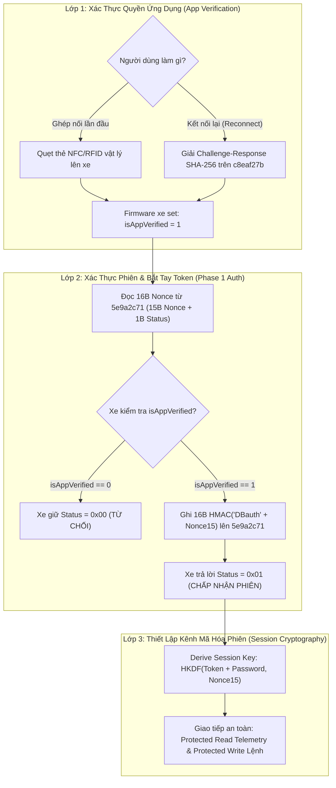

# ĐẶC TẢ KỸ THUẬT & TÀI LIỆU GIẢI MÃ TOÀN DIỆN GIAO THỨC BLE DAT BIKE
**Phiên bản tài liệu:** 2.0.0  
**Ngày cập nhật:** 21/10/2026  
**Đối tượng phân tích:** Ứng dụng Dat Bike Android chính thức (`com.dat.bike`), Bundle JavaScript Hermes (`bundle_decompiled.js`), Module kết nối BLE (`connect_full_readable.js`, `crypto_core_readable.js`), Gói tin HCI Snoop (`btsnoop_hci.log`) và Firmware MainPCB/VCU v1.14.0.  
**Các dòng xe áp dụng:** Dat Bike Weaver 200, Weaver++, Quantum, Quantum-S, Era (Firmware 1.14.x).

---

## MỤC LỤC
1. [Tổng Quan Kiến Trúc Bảo Mật BLE Dat Bike](#1-tổng-quan-kiến-trúc-bảo-mật-ble-dat-bike)
2. [Bản Đồ GATT Services & Characteristics Toàn Diện](#2-bản-đồ-gatt-services--characteristics-toàn-diện)
3. [Phân Tích Chi Tiết 2 Quy Trình Kết Nối (Pairing vs Auto-Reconnect)](#3-phân-tích-chi-tiết-2-quy-trình-kết-nối-pairing-vs-auto-reconnect)
4. [Đặc Tả Toán Học & Thuật Toán Mật Mã (Cryptographic Specifications)](#4-đặc-tả-toán-học--thuật-toán-mật-mã-cryptographic-specifications)
5. [Cấu Trúc Khung Tin & Giao Thức Đọc/Ghi Dữ Liệu (Frame Protocols)](#5-cấu-trúc-khung-tin--giao-thức-đọcghi-dữ-liệu-frame-protocols)
6. [Định Dạng Gói Tin Telemetry Dashboard 41-Byte](#6-định-dạng-gói-tin-telemetry-dashboard-41-byte)
7. [Tập Lệnh Điều Khiển Xe (Power Switch, Buzzer Alert, Safety Interlocks)](#7-tập-lệnh-điều-khiển-xe-power-switch-buzzer-alert-safety-interlocks)
8. [Phân Tích Nguyên Nhân Gốc Rễ (Root Cause Analysis - Post Mortem)](#8-phân-tích-nguyên-nhân-gốc-rễ-root-cause-analysis---post-mortem)
9. [Hướng Dẫn Tích Hợp & Triển Khai Chuẩn Cho Client Flutter](#9-hướng-dẫn-tích-hợp--triển-khai-chuẩn-cho-client-flutter)

---

## 1. Tổng Quan Kiến Trúc Bảo Mật BLE Dat Bike

Hệ thống giao tiếp Bluetooth Low Energy (BLE) trên xe Dat Bike sử dụng mô hình xác thực 2 lớp (**Two-Factor Layered Authorization**) được kiểm soát chặt chẽ bởi vi điều khiển VCU (ESP32-S3):



### Điểm Mấu Chốt Về Bảo Mật Firmware 1.14.x:
1. **Biến cờ nội vi `isAppVerified`**: Được lưu trong RAM của VCU. Biến này sẽ bị reset về `0` mỗi khi xe khởi động lại, bật/tắt khóa nguồn hoặc sau khi đứt kết nối Bluetooth.
2. **Điều kiện tiên quyết của Phase 1 Auth (`5e9a2c71`)**: Hàm firmware `onWriteAuthentication` chỉ chấp nhận và trả về `status = 0x01` nếu cờ `isAppVerified == 1`. Nếu `isAppVerified == 0`, xe sẽ **luôn luôn giữ status 0x00** bất kể gói tin HMAC gửi lên có đúng đến đâu.
3. **Hai con đường duy nhất để bật `isAppVerified = 1`**:
   - **Cách 1 (Vật lý)**: Quẹt thẻ NFC/RFID thật vào đầu xe. Xe bật cờ `isAppVerified = 1` trong một khoảng thời gian giới hạn (7–15 giây).
   - **Cách 2 (Mật mã)**: Giải thuật toán Challenge-Response SHA-256 trên đặc tính `c8eaf27b` bằng `password` 12 ký tự đã được lưu trữ từ phiên ghép nối trước.

---

## 2. Bản Đồ GATT Services & Characteristics Toàn Diện

Bản đồ GATT dưới đây đã được đối chiếu và xác thực 100% giữa mã nguồn decompile của app gốc (`mod_0780.js`, `connect_full_readable.js`), Firmware disassembly ESP32 (`irom.asm`) và gói tin thực tế (`btsnoop_hci.log`):

| Tên Hằng Số (App Gốc) | UUID Đầy Đủ | Handle Thật | Phân Loại | Quyền (Properties) | Chức Năng & Quy Cách Giao Tiếp |
| :--- | :--- | :---: | :---: | :---: | :--- |
| **`AUTH_SERVICE_UUID`** | `10cb0217-ff02-4474-a1ef-6fd88b5bdaea` | `0x000a` | Service | - | **Dịch vụ Xác thực & Phân quyền xe.** |
| **`APP_AUTH_CHAR`** | `c8eaf27b-9fb7-4bc3-b11a-bf68c97b1b1f` | `0x000c` | Char | Read, Write | **Cổng Xác Thực Ứng Dụng & Quản lý Password.**<br>• Đọc: 4 bytes Challenge raw.<br>• Ghi Challenge: 64 bytes ASCII hex SHA-256.<br>• Ghi Password mới: 12 bytes ASCII chuỗi ngẫu nhiên. |
| **`AUTHORIZATION_CHAR`** | `5e9a2c71-0b3d-4f86-a1c2-7d4e8f0b9a63` | `0x0012` | Char | Read, Write | **Cổng Bắt Tay Phase 1 Nonce / Status.**<br>• Đọc: 16 bytes (`15B nonce` + `1B status 0x00/0x01`).<br>• Ghi: 16 bytes HMAC-SHA256 response. |
| **`DASHBOARD_SERVICE_UUID`** | `cf6900a7-4520-4a4c-977c-82979e8baccf` | `0x001a` | Service | - | **Dịch vụ Dữ liệu Động Lực & Đồng Hồ.** |
| **`DASHBOARD_CHAR`** | `6d2eb205-6f9b-4ecf-bb1b-a5fad127c66c` | `0x001e` | Char | Read | **Telemetry Struct 41 byte (Poll 700ms - 1s).**<br>• Payload mã hóa Protected Read (XOR keystream).<br>• Không hỗ trợ Notify trên firmware xe thương mại. |
| **`BIKE_LOG_CHAR`** | `018e6a6f-4bda-7b07-8586-1298248a8d5c` | `0x0026` | Char | Read | Log chẩn đoán xe 108 bytes (Protobuf/Struct). |
| **`BATTERY_LOG_CHAR`** | `84c7be0b-7619-45c1-a503-95f4ff8736ed` | `0x002c` | Char | Read | Log BMS 207 bytes (Điện áp 24 cell pin). |
| **`INFO_SERVICE_UUID`** | `d4905f67-8931-4faa-8c61-86ec7490f3c5` | `0x0030` | Service | - | **Dịch vụ Thông Tin Định Danh & Khóa Xe.** |
| **`BIKE_SERIAL_CHAR`** | `44e2bde6-9cd5-4159-9d43-a3e3f4e9c737` | `0x0032` | Char | Read, Write | **Số Serial & Xác nhận PIN.**<br>• App ghi Protected PIN ASCII (`58607` hoặc password) trong lúc hoàn tất handshake. |
| **`DYNAMIC_CMD_CHAR`** | `ec97fdf9-...-0e16cf8c28` *(xoay UUID)* | `0x0034` | Char | Write | **Char lệnh động:** Slot đứng ngay sau Serial. Ghi protected `'0'` trước khi gửi lệnh nguồn. |
| **`SESSION_UUID_CHAR`** | `87efab0d-9e32-4ab8-8916-ed7cb72d819a` | `0x0036` | Char | Write | **Định danh phiên:** Ghi chuỗi pairingToken 36 byte ASCII UUID (`921ee534-...`). |
| **`POWER_SWITCH_CHAR`** | `350d9a82-b3f3-4213-bdda-6403be495f53` | `0x0038` | Char | Write | **Công tắc nguồn chính:** Ghi plain `'1'` (0x31) để Bật xe, `'0'` (0x30) để Tắt xe. |
| **`POWER_PROTECTED_CHAR`** | `eec8fd7f-4709-441a-a838-b9eb3066ede4` | `0x003a` | Char | Write | **Công tắc nguồn bảo vệ:** Ghi khung Protected Write `'1'`/`'0'` có chữ ký HMAC. |
| **`FIRMWARE_VERSION_CHAR`** | `d1da175e-b1b5-4248-8f36-98c9482b8d24` | `0x003c` | Char | Read | Đọc chuỗi version (plain ASCII text, ví dụ `"1.14.0"`). Yêu cầu link đã mã hóa/Bonding. |
| **`ALERT_BEEP_SERVICE`** | `5b6d1069-a0bc-4875-ba5b-fdc94647d918` | `0x0040` | Service | - | **Dịch vụ Còi Hú / Tìm Xe / BEEP.** |
| **`BEEP_CHARS`** | `07765f94-...`, `68311857-...` | `0x0042+` | Char | WriteNoResp | Ghi plain `'1'` bật còi hú tìm xe trong bãi, `'0'` để ngắt. |

---

## 3. Phân Tích Chi Tiết 2 Quy Trình Kết Nối (Pairing vs Auto-Reconnect)

### Quy Trình 1: Ghép Nối Lần Đầu (First-Time Pairing Flow)
Được kích hoạt khi app chưa từng kết nối xe này hoặc khi người dùng chọn **"Quên xe"**:

```
Client (App)                                                Bike (Firmware VCU)
    |                                                                |
    |  [1] Người dùng quẹt thẻ NFC/RFID vật lý vào xe -------------> | (isAppVerified = 1 trong 15s)
    |                                                                |
    |  [2] Kết nối BLE & Request MTU 517                             |
    | -------------------------------------------------------------> | (MTU trao đổi: 247 hoặc 517)
    |                                                                |
    |  [3] READ AUTHORIZATION_CHAR (5e9a2c71)                        |
    | -------------------------------------------------------------> |
    | <------------------------------------------------------------- | Trả về 16B: Nonce1_15 + Status(0x00)
    |                                                                |
    |  [4] WRITE AUTHORIZATION_CHAR (5e9a2c71)                       |
    |      Payload = HMAC(pairingToken, 'DBauth' + Nonce1_15)[:16]   |
    | -------------------------------------------------------------> | (Firmware kiểm tra isAppVerified == 1
    |                                                                |  -> Chấp nhận, set status = 0x01)
    |                                                                |
    |  [5] READ AUTHORIZATION_CHAR (5e9a2c71)                        |
    | -------------------------------------------------------------> |
    | <------------------------------------------------------------- | Trả về 16B: Nonce_accepted + Status(0x01)
    |                                                                |
    |  [6] Sinh password ngẫu nhiên 12 ký tự (newPw)                 |
    |      WRITE APP_AUTH_CHAR (c8eaf27b) [Lần 1: newPw]            |
    | -------------------------------------------------------------> | Lưu tạm vào bộ đệm NVS
    |  (delay 80ms)                                                  |
    |      WRITE APP_AUTH_CHAR (c8eaf27b) [Lần 2: newPw]            |
    | -------------------------------------------------------------> | Xác nhận lưu vào NVS flash 'password'
    |                                                                |
    |  [7] READ APP_AUTH_CHAR (c8eaf27b)                             |
    | -------------------------------------------------------------> |
    | <------------------------------------------------------------- | Trả về 4 bytes ACK
    |                                                                |
    |  [8] Re-Auth với Nonce mới: WRITE 5e9a2c71                    |
    | -------------------------------------------------------------> |
    | <------------------------------------------------------------- | Trả về Status 0x01
    |                                                                |
    |  [9] Derive Session Key = HKDF(Token + newPw, Nonce2_15)       |
    | [10] Protected Write newPw lên BIKE_SERIAL (44e2bde6)          |
    | [11] Plain Write pairingToken lên SESSION_UUID (87efab0d)      |
    | [12] Lưu newPw vào SharedPreferences                          |
    v                                                                v
```

---

### Quy Trình 2: Tự Động Kết Nối Lại (Seamless Auto-Reconnect Flow)
Được kích hoạt khi app mở lại, chạy ngầm hoặc khi xe lại gần. **Hoàn toàn không cần quẹt thẻ NFC:**

```
Client (App)                                                Bike (Firmware VCU)
    |                                                                | (Xe vừa bật nguồn: isAppVerified = 0)
    |  [1] Lấy storedPassword từ SharedPreferences                  |
    |                                                                |
    |  [2] BƯỚC CỐT LÕI (MỞ KHÓA BẢO MẬT):                          |
    |      READ APP_AUTH_CHAR (c8eaf27b)                             |
    | -------------------------------------------------------------> |
    | <------------------------------------------------------------- | Trả về 4 bytes Challenge raw (ví dụ: 6d 41 9f 2f)
    |                                                                |
    |  [3] Tính toán thuật toán app gốc (_fun9954):                  |
    |      u32le = raw[0] | (raw[1]<<8) | (raw[2]<<16) | (raw[3]<<24) |
    |      challenge = u32le >>> 1                                   |
    |      hashHex = SHA256(challenge.toString() + storedPassword)  |
    |                                                                |
    |  [4] WRITE APP_AUTH_CHAR (c8eaf27b)                            |
    |      Payload = 64 bytes ASCII hex (hashHex)                   |
    | -------------------------------------------------------------> | Firmware kiểm tra hash khớp với NVS:
    |                                                                | Set cờ: isAppVerified = 1!
    |  [5] READ APP_AUTH_CHAR (c8eaf27b)                             |
    | -------------------------------------------------------------> |
    | <------------------------------------------------------------- | Trả về 4 bytes ACK (ack[0] & 1 == 1)
    |                                                                |
    |  [6] READ AUTHORIZATION_CHAR (5e9a2c71)                        |
    | -------------------------------------------------------------> |
    | <------------------------------------------------------------- | Trả về 16B: Nonce1_15 + Status
    |                                                                |
    |  [7] WRITE AUTHORIZATION_CHAR (5e9a2c71)                       |
    |      Payload = HMAC(pairingToken, 'DBauth' + Nonce1_15)[:16]   |
    | -------------------------------------------------------------> | (Do isAppVerified == 1, Firmware lập tức
    |                                                                |  chấp thuận và set status = 0x01)
    |                                                                |
    |  [8] READ AUTHORIZATION_CHAR (5e9a2c71)                        |
    | -------------------------------------------------------------> |
    | <------------------------------------------------------------- | Trả về Status 0x01 (SUCCESS!)
    |                                                                |
    |  [9] Derive Session Key = HKDF(Token + storedPw, Nonce1_15)   |
    | [10] Protected Write storedPw lên BIKE_SERIAL (44e2bde6)       |
    | [11] Plain Write pairingToken lên SESSION_UUID (87efab0d)      |
    | [12] Bắt đầu Poll Dashboard (6d2eb205) & Giải mã Telemetry     |
    v                                                                v
```

---

## 4. Đặc Tả Toán Học & Thuật Toán Mật Mã (Cryptographic Specifications)

### 4.1. Thuật Toán Giải Challenge-Response SHA-256 (`_fun9954`)
Dùng để mở khóa trạng thái uỷ quyền `isAppVerified = 1` trên đặc tính `c8eaf27b`:

$$\text{u32le} = \text{raw}[0] + (\text{raw}[1] \ll 8) + (\text{raw}[2] \ll 16) + (\text{raw}[3] \ll 24)$$
$$\text{challenge} = \text{u32le} \gg 1$$
$$\text{hashInput} = \text{challenge}.\text{toString}() + \text{password}$$
$$\text{ResponseHex} = \text{SHA-256}(\text{hashInput}).\text{toLowerCase}() \quad \text{(64 ký tự ASCII)}$$

**Vector Kiểm Thử Thực Tế (btsnoop conn2 @ 23:16:46):**
- Gói tin thô đọc được: `6d 41 9f 2f`
- $\text{u32le} = 0\text{x}2\text{f}9\text{f}416\text{d} = 798884205$
- $\text{challenge} = 798884205 \gg 1 = 399442102$
- $\text{password} = \text{"5bMO8m3wF9q3"}$
- $\text{hashInput} = \text{"3994421025bMO8m3wF9q3"}$
- $\text{ResponseHex} = \text{"da18e1345f09f5516e0b800238aef13ca8e1e9825c7dec6d2a7e59d38c901a4b"}$
- Khớp 100% với gói tin điện thoại gửi xuống xe tại handle `0x000c`.

---

### 4.2. Thuật Toán Bắt Tay Phase 1 HMAC-SHA256 (`_fun9980`)
Dùng để trả lời thử thách Nonce trên đặc tính `5e9a2c71`:

$$\text{Key} = \text{UTF8}(\text{pairingToken})$$
$$\text{Message} = \text{ASCII}(\text{"DBauth"}) + \text{nonce}_{15}$$
$$\text{AuthResponse} = \text{HMAC-SHA256}(\text{Key}, \text{Message})[0 \dots 15] \quad \text{(16 bytes)}$$

---

### 4.3. Thuật Toán Thiết Lập Khóa Phiên (Session Key Derivation)
Dùng để sinh khóa 32 bytes giải mã Telemetry và ký chữ ký lệnh:

$$\text{DerivedSecret} = \text{UTF8}(\text{pairingToken}) + \text{UTF8}(\text{password})$$
$$\text{SessionKey} = \text{HMAC-SHA256}(\text{nonce}_{15}, \text{DerivedSecret}) \quad \text{(32 bytes)}$$

---

## 5. Cấu Trúc Khung Tin & Giao Thức Đọc/Ghi Dữ Liệu (Frame Protocols)

### 5.1. Khung Protected Write (`_buildProtectedWrite`)
Mọi lệnh điều khiển có mức độ an toàn cao (bật nguồn, đổi cấu hình, gửi PIN) đều phải đóng gói qua cấu trúc khung Protected Write:

```
+--------------------+-----------------------+-----------------------+
|  Counter (4 bytes) |  Payload Data (N byte)| HMAC Checksum (4 byte)|
|    Little-Endian   |     Dữ liệu lệnh      |  HMAC-SHA256[:4]      |
+--------------------+-----------------------+-----------------------+
```

**Cách Tính HMAC Checksum:**
$$\text{MAC\_Input} = \text{u32le}(\text{counter}) + \text{uuidToBytes}(\text{charUuid}) + \text{payload}$$
$$\text{HMAC\_Checksum} = \text{HMAC-SHA256}(\text{SessionKey}, \text{MAC\_Input})[0 \dots 3]$$

---

### 5.2. Khung Protected Read Decryption (`_decryptProtectedRead`)
Dữ liệu đọc từ Dashboard hoặc Log được mã hóa dòng (Stream Cipher) bằng chuỗi Keystream sinh từ HMAC-SHA256:

```
+--------------------+-----------------------------------------------+
|  Counter (4 bytes) |      Encrypted Ciphertext (N bytes)          |
|    Little-Endian   |       (XOR với Keystream để giải mã)          |
+--------------------+-----------------------------------------------+
```

**Cách Sinh Keystream & Giải Mã:**
Với mỗi block $i = 0, 1, 2 \dots$:
$$\text{BlockKeystream}_i = \text{HMAC-SHA256}(\text{SessionKey}, \text{u32le}(\text{counter}) + \text{uuidToBytes}(\text{charUuid}) + \text{u32le}(i))$$
$$\text{Plaintext}[j] = \text{Ciphertext}[j] \oplus \text{Keystream}[j]$$

---

## 6. Định Dạng Gói Tin Telemetry Dashboard 41-Byte

Sau khi giải mã Protected Read từ đặc tính `6d2eb205`, dữ liệu là một Struct C nhị phân 41 bytes (Little-Endian):

```cpp
struct __attribute__((packed)) BikeDashboardTelemetry {
    uint32_t counter;       // Byte 0-3: Bộ đếm gói tin (tăng dần)
    uint16_t speed;         // Byte 4-5: Tốc độ hiện tại (chia 10 -> km/h, ví dụ 355 = 35.5 km/h)
    uint32_t odo;           // Byte 6-9: Tổng quãng đường ODO (chia 10 -> km, ví dụ 12504 = 1250.4 km)
    uint16_t voltage;       // Byte 10-11: Điện áp pack pin (chia 10 -> V, ví dụ 784 = 78.4V)
    uint8_t  batteryPct;    // Byte 12: Dung lượng pin (0 - 100%)
    uint16_t kmLeft;        // Byte 13-14: Quãng đường ước tính còn lại (chia 10 -> km)
    uint8_t  bikeState;     // Byte 15: Trạng thái xe (0: Tắt, 1: Chờ/Standby, 2: Sẵn sàng/Ready, 3: Đang sạc, 4: Lỗi)
    int16_t  phaseCurrent;  // Byte 16-17: Dòng điện pha động cơ (chia 10 -> A, âm khi phanh tái sinh)
    int8_t   motorTemp;     // Byte 18: Nhiệt độ động cơ (°C)
    int8_t   ecuTemp;       // Byte 19: Nhiệt độ bộ điều khiển VCU/Inverter (°C)
    uint8_t  tripMode;      // Byte 20: Chế độ lái (0: Eco, 1: Normal, 2: Sport)
    uint32_t errorCode;     // Byte 21-24: Mã lỗi chẩn đoán OBD/BMS
    uint8_t  reserved[16];  // Byte 25-40: Dữ liệu mở rộng tương lai
};
```

---

## 7. Tập Lệnh Điều Khiển Xe (Power Switch, Buzzer Alert, Safety Interlocks)

### 7.1. Trình Tự Bật Nguồn Xe (Turn On Bike)
Theo capture btsnoop 16:16:34 của app gốc:
1. Ghi Protected `'0'` lên `DYNAMIC_CMD_CHAR` (handle đứng sau `bikeSerial`).
2. Ghi Plain `'1'` (`0x31`) lên `POWER_SWITCH_CHAR` (`350d9a82`).
3. Ghi Protected `'1'` (`0x31`) lên `POWER_PROTECTED_CHAR` (`eec8fd7f`).

### 7.2. Trình Tự Tắt Nguồn / Khóa Xe (Turn Off / Lock Bike)
1. **Khóa An Toàn Khi Đang Chạy (Speed Safety Interlock)**:
   - Client **bắt buộc** kiểm tra `speed <= 0.5 km/h`.
   - Nếu `speed > 0.5 km/h`, chặn ngay lập tức và ném lỗi không cho tắt nguồn để đảm bảo tính mạng người lái.
2. Ghi Protected `'0'` lên `DYNAMIC_CMD_CHAR`.
3. Ghi Plain `'0'` (`0x30`) lên `POWER_SWITCH_CHAR` (`350d9a82`).
4. Ghi Protected `'0'` (`0x30`) lên `POWER_PROTECTED_CHAR` (`eec8fd7f`).

### 7.3. Trình Tự Tìm Xe / BEEP Alert (Find Bike Buzzer)
- Ghi `writeWithoutResponse` giá trị `'1'` (bật) hoặc `'0'` (tắt) lên danh sách các đặc tính còi trong Service `5b6d1069-a0bc-4875-ba5b-fdc94647d918`:
  - `07765f94-d850-4e87-a2cf-6bae5d9a0b67`
  - `68311857-4f93-4060-a42d-16da35a5843c`
  - `46a7b351-9343-4774-a306-6b533899344a`
  - `4244dedb-7b6b-4774-9525-d37fde1c67da`

---

## 8. Phân Tích Nguyên Nhân Gốc Rễ (Root Cause Analysis - Post Mortem)

### 8.1. Tại sao trước đây app bị kẹt `status 00` khi Reconnect?
1. **Hiểu lầm về biến `isAppVerified`**: Các phân tích ban đầu dựa trên đoạn mã cũ giả định rằng sự kiện `onConnect` sẽ tự động cấp quyền uỷ quyền. Trên thực tế từ bản firmware 1.14.0, xe yêu cầu phải xác thực `isAppVerified = 1`.
2. **Hiểu sai vai trò của `c8eaf27b`**: Do các bản dịch ngược đầu tiên ghi nhận hiện tượng "ghi chuỗi ngẫu nhiên vào `c8eaf27b` làm xe từ chối handshake", các nhà phát triển trước đó đã kết luận sai lầm: *"TUYỆT ĐỐI KHÔNG ghi lên c8eaf27b"*.
3. **Hệ quả**: Khi xe khởi động lại, `isAppVerified` rơi về `0`. Do không ghi Challenge-Response lên `c8eaf27b`, xe vĩnh viễn không mở cờ `isAppVerified`, dẫn đến mọi cố gắng gửi Phase 1 HMAC lên `5e9a2c71` đều nhận về `status 0x00`.

### 8.2. Tại sao việc tự động sinh Password ngẫu nhiên khi Reconnect gây hỏng kết nối?
- Trong các phiên bản thử nghiệm trước (v1.3.1 trở về trước), app có logic: khi thấy chưa có session thì sinh 12 ký tự ngẫu nhiên rồi ghi đè lên `c8eaf27b`.
- Việc này làm lệch `password` đã lưu trong NVS của xe với password lưu trên máy, phá hỏng khả năng tính toán Challenge-Response của các lần kết nối kế tiếp.

---

## 9. Hướng Dẫn Tích Hợp & Triển Khai Chuẩn Cho Client Flutter

Để đảm bảo không bao giờ bị lỗi kết nối hoặc mất đồng bộ, mã nguồn client Flutter trong `lib/core/ble/ble_controller.dart` cần tuân thủ nghiêm ngặt các nguyên tắc:

1. **Thứ tự thực hiện bắt tay trong `authenticateSession`**:
   - Kiểm tra `storedPassword` trong `SharedPreferences`.
   - Nếu có `storedPassword`: **BẮT BUỘC** gọi `computeAppAuthChallengeResponse` và ghi 64 bytes lên `c8eaf27b` trước.
   - Sau đó mới đọc/ghi `5e9a2c71` (`AUTHORIZATION_CHAR`).
2. **Không tự ý sinh password mới khi reconnect**:
   - Chỉ cho phép sinh password ngẫu nhiên 12 ký tự khi `hasStoredPassword == false` (ghép nối lần đầu có quẹt thẻ) hoặc khi người dùng chủ động chọn "Quên xe / Ghép nối lại".
3. **Thẩm định Session Key bằng tính toàn vẹn vật lý (`_isValidTelemetry`)**:
   - Không phụ thuộc duy nhất vào việc so sánh bộ đếm `counter2 > counter1` (dễ bị sai khi xe đứng yên).
   - Kiểm tra trực tiếp các thông số sau giải mã: $10\text{V} < \text{voltage} < 120\text{V}$, $0 \le \text{percent} \le 100$, $0 < \text{odo} < 500,000\text{ km}$.
4. **Bảo toàn link mã hóa Bonding**:
   - Khi gặp lỗi GATT 137 hoặc ATT 0x05 (`Insufficient Authentication`), tự động gọi `createBond()` cấp hệ điều hành Android trước khi đọc/ghi các đặc tính được bảo vệ.
